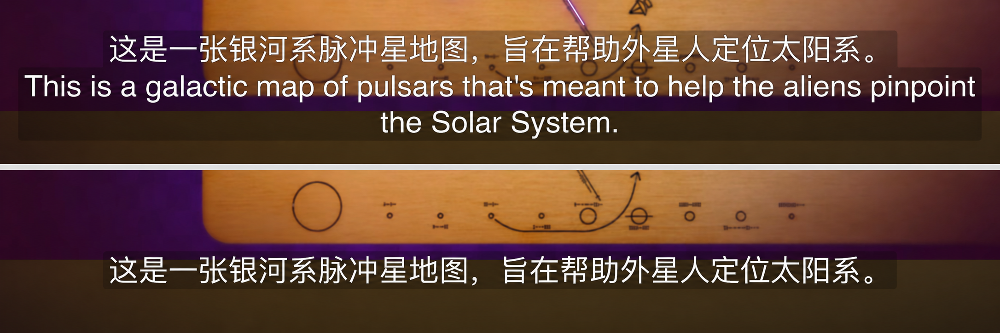
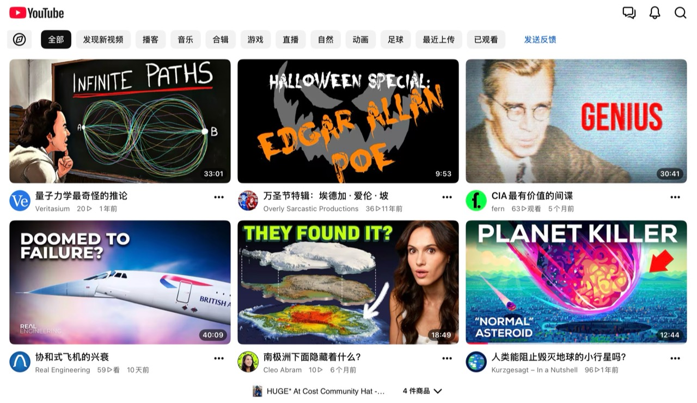

<div align="center">

# YouTube Bilingual

**Read YouTube captions, titles and comments in a language you understand.**

Official YouTube app on iPhone / iPad · Quantumult X / Shadowrocket · Your own AI API

[简体中文](README.md) · [Get started](#install) · [Translation settings](#settings) · [FAQ](#faq)

</div>

> Current stable release: **v2.1.0** (2026-11-10). [Release notes](releases/v2.1.0.md) · [Previous versions](https://github.com/qutary/youtube-bilingual/releases).

## What it does

- **Bilingual captions**: translation above original, original above translation, or translation only.
- **Interface translation**: supported titles, descriptions, recommendations, comments and replies, channels, posts, playlists, watch history and some Shorts text.
- **Supported languages**: Chinese, English, Japanese, Korean, French, Russian, German, Portuguese, Spanish, Italian, Hindi, Thai and Arabic.
- **Four API options**: DeepSeek, Volcengine Ark, OpenRouter and custom OpenAI-compatible APIs, connected to both captions and interface translation.
- **Caching and ad filtering**: reuses completed translations and integrates YouTube ad handling.

Videos must already have a caption track; this project does not generate captions from audio. Interface translation handles supported text, not words inside images or video frames.

## Translation examples

### Caption display

<p align="center">
  <a href="docs/images/youtube-subtitle-comparison.png"></a>
</p>

Top: Chinese and English captions. Bottom: Chinese translation only.

### Interface translation

<p align="center">
  <a href="docs/images/youtube-ui-translation-example.jpg"></a>
</p>

Example: homepage video titles translated into Chinese. Text inside thumbnails remains unchanged.

<a id="install"></a>

## Get started

You need the official YouTube app, **either Quantumult X or Shadowrocket**, a working translation API key, and a network that can play YouTube and reach your API. Your chosen provider bills API usage.

Setup takes three steps: **add the module/rewrite → add BoxJS settings → enter your key and select captions**.

### 1. Add the module or rewrite

Use the resource for your active proxy app. Disable older or duplicate YouTube caption, interface translation and ad-filtering rules. Keep the BoxJS base resource enabled.

**Quantumult X**: add and enable this URL as a remote rewrite resource.

```text
https://raw.githubusercontent.com/qutary/youtube-bilingual/main/qx/YouTube.Bilingual.snippet
```

**Shadowrocket**: add and enable this URL as a module. Translation settings are managed in BoxJS.

```text
https://raw.githubusercontent.com/qutary/youtube-bilingual/main/shadowrocket/YouTube.Bilingual.shadowrocket.module
```

**Keep the proxy connection, module/rewrite and HTTPS decryption (MitM) enabled, with the corresponding certificate installed and trusted.** Importing a URL alone does not complete these steps.

### 2. Add BoxJS settings

Both proxy apps use BoxJS to configure this project. If BoxJS already opens correctly, add the project subscription below. Otherwise, expand the setup instructions first.

<details>
<summary>Install BoxJS for the first time</summary>

Add the base resource for your active proxy app and follow the [official BoxJS documentation](https://docs.boxjs.app/) to finish setup.

QX base rewrite:

```text
https://raw.githubusercontent.com/chavyleung/scripts/master/box/rewrite/boxjs.rewrite.quanx.conf
```

Shadowrocket base module:

```text
https://raw.githubusercontent.com/chavyleung/scripts/master/box/rewrite/boxjs.rewrite.surge.sgmodule
```

Keep the proxy app running and open this address in your browser:

```text
http://boxjs.com
```

</details>

In BoxJS **Subscriptions**, add **either the Chinese or English edition**. The same subscription works with QX or Shadowrocket.

**Chinese settings**

```text
https://raw.githubusercontent.com/qutary/youtube-bilingual/main/qx/youtube-bilingual.boxjs.json
```

**English settings**

```text
https://raw.githubusercontent.com/qutary/youtube-bilingual/main/qx/youtube-bilingual.en.boxjs.json
```

The edition changes settings labels, not the translation target. **QX and Shadowrocket store data separately; API keys and other settings do not automatically sync between them.**

### 3. Enter your key and start watching

1. Choose a translation service in BoxJS **Caption settings**, then open that service's configuration and enter your **API key and model ID**. Custom APIs also need a full endpoint URL.
2. Choose your target language and display mode. Leave **Caption source language** on **Auto-detect** initially, then save.
3. Open a YouTube video and select an available original track under **CC / Captions**, such as English or English (auto-generated). If you specify the source language manually, it must match the selected track.

Interface translation is enabled by default. Turn off any unwanted categories under **Interface translation**, save, then reopen the relevant page so a new request uses your settings.

<a id="settings"></a>

## Translation settings

### Choose an API service

**DeepSeek is recommended.** You can also use an existing Volcengine Ark, OpenRouter or custom API account.

| Service | Required settings | Translates |
| --- | --- | --- |
| [DeepSeek](https://platform.deepseek.com/) | API key and model ID | Captions and interface text |
| [Volcengine Ark](https://console.volcengine.com/ark) | API key and model or inference endpoint ID | Captions and interface text |
| [OpenRouter](https://openrouter.ai/) | API key and full model ID, including provider prefix | Captions and interface text |
| Custom API | Key, model ID and full HTTPS Chat Completions URL | Captions and interface text; requires compatibility |

Captions and interface translation use the selected service's settings. A failed request does not switch to a different service. For custom APIs, enter the complete request path, such as `https://your-domain.example/v1/chat/completions`, rather than the domain alone.

### Everyday controls

| What you want | Change in BoxJS |
| --- | --- |
| Translation above the original | Text display mode → Bilingual: translation above original |
| Original above the translation | Text display mode → Bilingual: original above translation |
| Translation only | Text display mode → Translation only |
| A different target language | Target language; shared by captions and interface text |
| Captions only | Turn off interface translation |
| Interface text only | Turn off video caption translation |
| Fewer types of translated content | Turn off the relevant interface category |

Captions and interface text share the display mode. Turning either translation feature off leaves the other feature and integrated ad filtering active. Channel names, view counts and publication dates remain unchanged and are not sent for translation; no new toggle is needed. Channel biographies can still be translated.

<details>
<summary>Advanced: concurrency, wait budget and cache</summary>

- **Concurrent requests**: default 20 per service; integers 1–256. Caption and interface queues each use the selected service's setting. Reduce it if rate-limited; higher is not always faster.
- **Caption wait budget**: default 6.3 seconds; range 3–10 seconds. This limits script processing, excludes the upstream YouTube network time, and does not control the interface translation deadline.
- **Reasoning policy**: automatic across all four services, with no toggle. Reasoning stays off when possible; required models use the lowest identifiable supported effort. If the API provides insufficient capability information, original text is preserved rather than enabling a potentially high effort. Previous reasoning settings are ignored.
- **JSON output mode**: leave on Auto unless you have a specific reason to change it. Turn it off if your model rejects the parameter.
- **Translation cache**: completed results can be reused on later requests. Interface entries are separated by target language, service, endpoint and model. Switching service or target does not require clearing all caches first.
- **Clear cache**: enable **Clear all translation cache (once)** and save. It runs on the next YouTube request and resets after success, keeping your key and other settings. The two current-language clearing options must be switched back to On manually.

Clearing the cache does not refresh pages or captions already loaded by YouTube. After changing settings, save and reopen the video or relevant page.

</details>

## Updates and rollback

**Update both the project module/rewrite and the BoxJS subscription, keeping saved data.** This page provides stable subscription URLs that can be refreshed for updates. Replace older test URLs with the URLs on this page first.

Older Shadowrocket module arguments are not imported into BoxJS automatically. When switching for the first time, save your original key, model and other settings in Shadowrocket's BoxJS. Existing values in that app's BoxJS can be reused. Changing between Chinese and English settings does not require entering your key again.

Use [Releases](https://github.com/qutary/youtube-bilingual/releases) for stable versions and historical rollback instructions. Disable the current rules before rolling back.

<a id="faq"></a>

## FAQ

**Where should I start if nothing is translated?** Confirm that YouTube plays, the proxy connection and module/rewrite are enabled, and the MitM certificate is trusted. Then check your selected service's key, model and quota. Captions also need an available original track; interface translation needs the relevant category enabled.

**Why is only part of the content translated?** API timeouts, rate limits, model output or unsupported layouts can leave original text in place. Completed translations are cached, and later requests can fill gaps. Captions already loaded by the player do not update live. Descriptions can show completed segments while other parts remain untranslated; other long content may also need a later request.

**YouTube says captions could not be loaded. What can I try?** If the error appears immediately on entering a video, try a different proxy node. For a long video, wait about 5–6 seconds, then leave and reopen it. If the problem persists, check for duplicate caption rules and try a shorter video.

**The API returns 401 / 403 / 429.** For 401/403, check your key, model permissions and the provider's response. For 429, check your balance, quota and rate limits, and lower concurrency if needed. Avoid changing unrelated settings repeatedly.

**BoxJS will not open, or a subscription shows Format Error.** Check the BoxJS base resource and proxy connection, then refresh the subscription and confirm that its URL downloads complete content. If it still fails, share a redacted BoxJS error rather than wiping all application data.

**The page is still Chinese after adding English settings.** Open the new **Caption settings** page from the BoxJS Apps list instead of staying on an older Chinese page. The project's settings language, BoxJS navigation language and translation target are separate settings.

## Coverage and privacy

Interface translation relies on text fields in YouTube requests. Different client layouts, some Shorts and new pages may still be incomplete. Long videos, network conditions and model speed also affect completion. All 13 languages and four API options are connected; results for individual models, language directions and pages depend on actual use.

Caption text and enabled categories of interface text are sent to your chosen API provider. Comments, posts and history titles may contain personal information, so enable categories as needed. Translations are cached locally and can be cleared in BoxJS.

To [report an issue](https://github.com/qutary/youtube-bilingual/issues/new), include your device and OS, YouTube/proxy versions, provider and model, video or page URL, and reproduction steps. Remove **API keys, Cookie, Authorization, signed URL parameters and personal identifiers** before sharing logs.

## Credits

[Maasea / sgmodule](https://github.com/Maasea/sgmodule) provides YouTube ad handling; its Apache-2.0 notices are retained.

This project is not affiliated with YouTube or Google.
