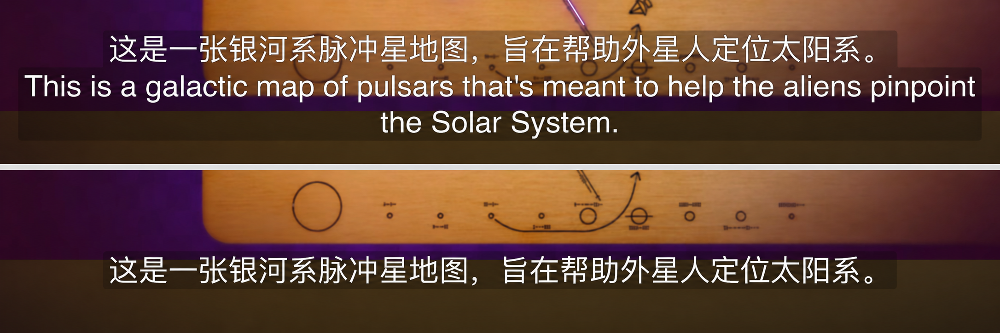

# YouTube Bilingual Subtitles

在 YouTube 官方 iPhone / iPad App 中显示中英双语字幕。

支持 Shadowrocket 和 Quantumult X，翻译使用自己的 AI API。

[安装](#安装) · [常见问题](#常见问题) · [反馈问题](https://github.com/qutary/youtube-bilingual-subtitles/issues)

## 字幕效果

  

上：中英双语；下：仅中文。

## 安装

需要准备：

- iPhone 或 iPad，以及 YouTube 官方 App。
- Shadowrocket 或 Quantumult X，任选一款。QX 另外需要 BoxJS。
- 一个可用的翻译 API Key；API 费用由服务商收取。
- 能正常播放 YouTube、访问翻译接口的网络。

| 代理工具 | 安装内容 | 设置位置 | 教程 |
| --- | --- | --- | --- |
| Shadowrocket | 字幕模块 | 模块「编辑参数」 | [安装与使用](shadowrocket/README.md) |
| Quantumult X | 字幕重写 + BoxJS 配置订阅 | BoxJS | [安装与使用](qx/README.md) |

**使用时需要开启代理工具的连接、字幕模块 / 重写和 HTTPS 解密（MitM）。** 导入订阅只是安装步骤，不会自动完成这些设置。

本项目不提供节点；请先确认 YouTube 本身能正常播放，再配置字幕。

安装完成后，在 YouTube 的 **CC / 字幕** 菜单选择 **English** 或 **English (auto-generated)** 原字幕轨。

## 翻译服务

| 服务 | 配置内容 | 服务商入口 |
| --- | --- | --- |
| DeepSeek | API Key、模型 ID | [开放平台](https://platform.deepseek.com/) |
| 火山方舟 | API Key、模型 ID 或接入点 ID | [控制台](https://console.volcengine.com/ark) |
| OpenRouter | API Key、完整模型 ID | [OpenRouter](https://openrouter.ai/) |

**自定义 API 尚未测试。** 代码保留了相关设置，目前不能确认是否可用。

## 版本与更新

**当前正式版本：v1.6.0（2026-11-08）**。保留 v1.5.0 以便出现兼容性问题时回退，正式安装地址保持不变。

- [查看 GitHub Releases](https://github.com/qutary/youtube-bilingual-subtitles/releases) — 最新版本与历史版本的发行说明。
- [v1.6.0 更新内容](releases/v1.6.0.md) — 自动字幕断句、上下文翻译与显示调整。
- [v1.5.0 历史版本及回退地址](releases/v1.5.0.md) — 使用固定 Git 提交，不受最新版影响。

升级前停用其他版本的字幕重写，不要同时启用多个版本。更新后如出现加载问题，可先回退到 v1.5.0，并提供脱敏 QX / Shadowrocket 日志排查。v1.6.0 的真实 API 与全量设备场景仍在持续验证。

## 日常使用

- **切换显示方式**：Shadowrocket 修改「仅显示中文字幕」；QX 修改 BoxJS「字幕显示方式」。
- **修改设置后**：保存，退出视频再重新进入，让 YouTube 重新加载字幕。
- **暂时停用**：关闭「启用翻译 / 开启字幕翻译」，或停用本项目模块 / 重写。
- **更新**：更新模块 / 重写订阅；QX 同时刷新 BoxJS 配置订阅。更新后检查自己的 Key 和模型设置。

## 常见问题

### 只有英文，没有中文

按顺序检查：

1. 代理工具的连接是否开启，视频是否能正常播放。
2. 本项目模块 / 重写是否启用，有没有同时启用其他字幕改写模块。
3. API Key、模型 ID、账号权限和额度是否正确。

### 为什么有些句子还是英文？

翻译需要时间，一次字幕请求可能只完成了部分内容。未完成的片段会保留英文，已完成的译文会缓存。退出视频再进入，有机会继续补齐；播放器已加载的字幕不会实时更新。

### 提示「加载字幕时出错」

一小时以上长视频较常见，通常是一次没能翻译完。先等待 **5–6 秒**，再退出视频并重新进入，一般就能正常加载字幕。

如果**刚进入视频就立即提示错误**，通常与当前节点有关，先更换节点再试。

### 修改设置后没有生效

保存后退出视频再重新进入，确认没有其他 YouTube 字幕改写模块同时启用。

### BoxJS 打不开，或找不到本项目（QX）

- **BoxJS 打不开**：检查 QX 连接是否开启、BoxJS 是否安装完整，按 [BoxJS 文档](https://docs.boxjs.app/)排查。
- **找不到本项目**：检查本项目的 BoxJS 配置订阅是否已添加并刷新。

### 翻译接口返回 401、403 或 429

- **401 / 403**：检查 API Key、账号权限和服务商返回的具体信息。
- **429**：检查额度和限流要求，必要时降低并发。

## 隐私与反馈

字幕文本会发送给你选择的 AI 服务商，请留意其数据处理政策和计费规则。不要公开 API Key、证书私钥或带有凭证的配置和日志。

遇到问题可[提交 Issue](https://github.com/qutary/youtube-bilingual-subtitles/issues/new)。请提供设备、系统与 App 版本、代理工具、翻译服务和模型、视频链接、字幕轨及复现步骤。日志中的 API Key、Authorization、Cookie 和 URL 签名参数需要先去除。

本项目与 YouTube / Google 无官方关联。字幕效果受客户端版本、字幕格式、网络和翻译服务影响。
